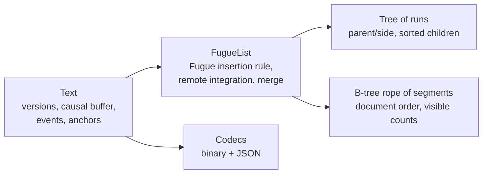

# fugue-text

A TypeScript implementation of the Fugue text CRDT for local-first collaborative editing:
concurrent edits merge without a server, and text typed at the same place does not interleave.

[](https://github.com/aozmekik/fugue-text/actions/workflows/ci.yml)
[](LICENSE)

> **Status:** early, v0.1.0. The API and the encodings may change. Not yet published to npm.

## Why

Collaborative editors built on CRDTs let every replica edit offline and merge later. Many list
CRDTs, however, can _interleave_ concurrent insertions at the same position: two people typing
"eggs" and "bread" after the same line may end up with `ebgrgesad`. Weidner and Kleppmann's
[_The Art of the Fugue_](https://arxiv.org/abs/2305.00583) shows how to avoid this with a tree
whose in-order traversal is the document. This library implements that algorithm (Fugue) with the
engineering a real editor needs: fast index lookups on long documents, run-length encoding,
causal delivery, state merging, compact encodings, stable cursors and change events. It has no
runtime dependencies and uses no platform-specific APIs. The test suite was run locally on
Node.js 22.22.3 and is set up to run in CI on Node.js 22 and 24; the browser example was checked
by hand in Chrome 152.

## Features

- **Fugue semantics**: left/right children, sibling order by ID, in-order traversal; checked
  against a naive transcription of the paper's algorithm.
- **Fast on long documents**: O(log n) mapping between visible indexes and element IDs through a
  B-tree of run segments.
- **Run-length encoding**: sequential typing is stored, sent and encoded as one run.
- **Operation-based sync**: serialisable operations, causal delivery with a buffer for
  out-of-order arrival, idempotent redelivery.
- **State-based sync**: save, load and merge whole states (commutative, associative, idempotent).
- **Compact, deterministic encodings**: binary (varints, run-length records) and JSON for
  debugging; converged replicas produce byte-identical states.
- **Anchors**: caret and selection positions that survive concurrent edits.
- **Change events** for local and remote edits, to update a view incrementally.

## Install

Not yet published to npm. Install from GitHub (the `prepare` script builds the package):

```sh
npm install github:aozmekik/fugue-text
```

Requires Node.js 22 or newer (or a current browser through a bundler). ESM only. Indexes count
UTF-16 code units, like JavaScript strings and `<textarea>`. The type declarations use generic
typed arrays and need TypeScript 5.7 or newer.

## Quick start

```ts
import { Text, decodeOperation, encodeOperation } from 'fugue-text';

const alice = new Text({ replicaId: 'alice' });
const bob = new Text({ replicaId: 'bob' });

// Local edits apply immediately and return an operation to broadcast.
const op = alice.insert(0, 'milk\n');
if (op) bob.apply(op);

// Concurrent edits at the same position...
const fromAlice = alice.insert(5, 'eggs\n');
const fromBob = bob.insert(5, 'bread\n');

// ...can be delivered in any order, any number of times, as objects, JSON or bytes.
if (fromBob) alice.apply(decodeOperation(encodeOperation(fromBob)));
if (fromAlice) {
  bob.apply(fromAlice);
  bob.apply(fromAlice); // returns 'duplicate'
}

alice.toString() === bob.toString(); // true: "milk\neggs\nbread\n"
```

## API overview

| Member                                                           | Purpose                                                                                                                 |
| ---------------------------------------------------------------- | ----------------------------------------------------------------------------------------------------------------------- |
| `new Text({ replicaId? })`                                       | A new, empty replica. The ID defaults to a random 12-character string.                                                  |
| `text.insert(index, string)`                                     | Inserts locally; returns an `InsertOperation` (or `undefined` for `''`).                                                |
| `text.delete(index, length)`                                     | Deletes locally; returns a `DeleteOperation` (or `undefined` for 0).                                                    |
| `text.toString()`, `text.length`                                 | The current text and its length in UTF-16 code units.                                                                   |
| `text.apply(op)`                                                 | Integrates a remote operation: `'applied'`, `'buffered'` or `'duplicate'`.                                              |
| `text.pendingCount`                                              | Operations waiting for missing causal dependencies.                                                                     |
| `text.version`                                                   | Version vector (next expected counter per replica).                                                                     |
| `text.save()` / `Text.load(state)`                               | Encode / decode the full state (binary).                                                                                |
| `text.toJSON()`                                                  | The full state as readable JSON (`Text.load` accepts it too).                                                           |
| `text.merge(state)`, `mergeStates(a, b)`                         | State-based merge.                                                                                                      |
| `text.createAnchor(index, bias?)` / `text.resolveAnchor(anchor)` | Positions that survive edits.                                                                                           |
| `text.subscribe(listener)`                                       | Change events `{ origin: 'local' \| 'remote', changes }`; returns an unsubscribe function.                              |
| `encodeOperation(op)` / `decodeOperation(bytes)`                 | Binary operation codec (JSON works as is).                                                                              |
| `assertOperation(value)`                                         | Validates an operation parsed from untrusted input.                                                                     |
| `FugueTextError`                                                 | Thrown for malformed or inconsistent remote input (`code`: `invalid-operation`, `invalid-state` or `replica-conflict`). |

Operations, anchors and version vectors are plain JSON values. Applying the `changes` of a change
event in order to the previous string yields the new string, so a view can be patched without
re-rendering everything.

```ts
const caret = text.createAnchor(6); // sticks to the character on its left
const stop = text.subscribe(({ origin, changes }) => render(changes));
// ...remote operations arrive...
const index = text.resolveAnchor(caret); // the caret's index now
```

Replica IDs must be unique per live instance. Reuse an ID only when loading a state that contains
every operation that ID has produced; otherwise use a fresh one (the default).

## How it works



- **Tree of runs.** Every character is a node of the Fugue tree, but a chain of characters typed
  one after another by the same replica is stored as one _run_. A local insert follows the paper:
  if the character before the cursor has no right child, the new text becomes its right child;
  otherwise it becomes the left child of the next element in document order.
- **Rope.** The tree's in-order traversal is kept in a B-tree of segments (slices of runs), with
  visible-character counts in every node and back-pointers from segments to leaves. Index to
  element and element to index are both O(log n). A remote insertion is placed right before the
  subtree of its next-greater sibling, or after the end of its parent's subtree.
- **Causality.** Each replica numbers its insertions (one counter per character) and deletions
  (one counter each) in one sequence. An operation carries the version-vector entries that
  changed since its sender's previous operation; receivers buffer it until those are satisfied.
- **Encoding.** States are encoded in document order as run-length records with varint and
  zigzag-delta integers; text is WTF-8 so even lone surrogates round-trip.

Design decisions and their trade-offs are recorded as ADRs:

1. [Tree of runs with a B-tree rope](docs/adr/0001-tree-of-runs-with-a-b-tree-rope.md)
2. [Causal delivery with delta dependencies](docs/adr/0002-causal-delivery-with-delta-dependencies.md)
3. [Deterministic, compact state encoding](docs/adr/0003-deterministic-compact-state-encoding.md)
4. [Fugue, not FugueMax, in v0.1](docs/adr/0004-fugue-not-fuguemax.md)

## Correctness

`npm test` runs 87 tests in 10 files (Vitest 5.0.5, Node.js 22.22.3), including:

- **Convergence**: 2 to 5 replicas make random concurrent edits; operations are delivered in
  random order, duplicated, round-tripped through JSON and the binary codec, and mixed with state
  merges. All replicas must end with the same text, the same version and byte-identical encoded
  states, and a mirror string maintained only from change events must match after every step.
- **Differential testing** against [`test/support/reference.ts`](test/support/reference.ts), a
  naive transcription of the paper's Algorithm 1: every local insert must pick the same parent and
  side for every character, and every replica must show the same text after every delivery.
- **The paper's scenarios** (Figures 1, 2, 6 and 7) and properties: two or three users typing
  forwards, or backwards, at the same position on a random document never interleave.
- **Merge laws**: `mergeStates` is commutative, associative and idempotent on random states, and
  state-based sync agrees with operation-based sync.
- **Codecs**: round trips of arbitrary UTF-16 strings, fuzzing of both decoders with random and
  corrupted bytes (they may only throw `FugueTextError`), and specific malformed states.
- **Structure**: a model-based test of the B-tree, and an invariant check (rope order equals the
  tree traversal, maximal segments and runs, sorted siblings) after every property-test step.

Coverage from `npm run test:coverage` on the same setup: 99.83% of lines, 97.09% of branches and
100% of functions in `src/` (excluding `src/types.ts`, which only declares types). Property tests draw new random inputs on each run, so branch
coverage varies by a fraction of a percent between runs.

## Benchmarks

All numbers below were measured on an Apple M1 Pro (8 cores, 16 GB) running macOS 26.6, Node.js
22.22.3 (V8 12.4), Yjs 13.6.33, on 2026-10-18. Other jobs were running on the machine at the same
time (load average between 14 and 28 during the runs), so expect noticeable noise; the raw
durations of every run are written to `bench/out/`.

### Real editing trace

`npm run bench` replays the
[automerge-paper trace](bench/traces/README.md) (259,778 single-character edits made while writing
a LaTeX paper; final length 104,852 characters; CC BY 4.0, Martin Kleppmann) on one replica,
then delivers the resulting operations to a second replica. Each timing is the median of 7 runs
after 2 warm-up runs. Retained heap is measured in a fresh process per library after a forced GC.

| Metric                                                  | fugue-text | Yjs 13.6.33                    |
| ------------------------------------------------------- | ---------- | ------------------------------ |
| Local replay, edits/s                                   | 3,261,945  | 224,398                        |
| Remote replay from binary messages, edits/s             | 879,711    | 280,196                        |
| Remote replay from in-memory operation objects, edits/s | 2,908,940  | n/a (updates are binary)       |
| Save full state, ms                                     | 4.0        | 4.4                            |
| Load full state, ms                                     | 13.7       | 16.4                           |
| Encoded state, bytes                                    | 176,415    | 223,414 (v2 encoding: 159,921) |
| Encoded state after gzip, bytes                         | 80,574     | 99,895                         |
| State as JSON, bytes                                    | 1,539,776  | n/a                            |
| Operations or updates, binary, bytes per edit           | 18.8       | 14.7                           |
| Retained heap after replay, bytes                       | 4,950,384  | 3,164,928                      |

The trace produced 6,288 runs and 12,487 segments in fugue-text. Across the 7 runs, local replay
took 73.7 to 103.9 ms for fugue-text and 1,141 to 1,246 ms for Yjs; save and load times varied by
more than 2x for both libraries (for example 2.6 to 8.5 ms to save in fugue-text), so they do not
rank the two libraries.

### Cost per edit versus document size (synthetic)

`npm run bench:scaling` builds documents from random typing bursts (synthetic data), then times
10,000 random single-character edits (alternating insert and delete at uniformly random
positions) on fresh copies; median of 5 repetitions. The naive reference implementation from the
test suite (O(n) per edit) shows what the B-tree avoids.

| Document length | fugue-text local, ns/edit | fugue-text remote, ns/edit | Yjs local, ns/edit | Naive reference, ns/edit |
| --------------- | ------------------------- | -------------------------- | ------------------ | ------------------------ |
| 1,005           | 883                       | 1,495                      | 5,382              | 96,305                   |
| 10,002          | 893                       | 908                        | 8,209              | 470,705                  |
| 100,004         | 1,426                     | 1,639                      | 39,222             | not run (O(n))           |
| 1,000,005       | 6,423                     | 4,799                      | 407,787            | not run (O(n))           |

### Caveats

These benchmarks give context; they are not a verdict on Yjs. Yjs is a mature framework with
rich types, awareness, transactions, observers, undo and garbage collection of deleted content,
and each `Y.Text` edit here runs in its own transaction with that machinery; fugue-text is a
single-purpose plain-text CRDT without tombstone garbage collection. The trace is a single-user
history, so it exercises sequential typing and never the concurrent-placement path. Uniformly
random positions in the scaling benchmark defeat the locality that Yjs's position cache relies on
and are not how people edit. Operation sizes depend on replica ID length (fugue-text sends the ID string in
every operation; Yjs uses numeric client IDs). Results come from one machine under load.

## Examples

- [`examples/broadcast-channel`](examples/broadcast-channel): a collaborative `<textarea>` across
  browser tabs over `BroadcastChannel`. `npm run example:browser`, then open
  http://127.0.0.1:8787 in two tabs. The binding keeps your caret in place while others type.
- [`examples/websocket-relay`](examples/websocket-relay): a tiny Node.js WebSocket relay (using
  the `ws` package, a dev dependency) that forwards operations and serves its state to late
  joiners, with a client and an end-to-end demo: `npm run example:relay`.

## Limitations and roadmap

Current limitations:

- Tombstones are never garbage-collected, so memory and state size grow with editing history.
- No FugueMax variant (see [ADR 0004](docs/adr/0004-fugue-not-fuguemax.md)).
- Plain text only: no formatting marks, embedded objects or undo.
- Indexes are UTF-16 code units; deleting half of a surrogate pair is allowed (and round-trips).
- Synchronisation sends either single operations or whole states; there is no delta sync from a
  version vector yet, and the buffer of early operations is unbounded.
- Placing concurrent remote insertions walks `leftmost`/`rightmost` paths of the tree, which is
  linear in the number of runs on that path (see ADR 0001).

Roadmap (not committed):

- FugueMax as an opt-in algorithm with its own differential reference.
- Delta synchronisation (`changesSince(version)`) and a bounded operation buffer.
- Tombstone compaction for parts of the document every replica has seen.
- A concurrent editing-trace benchmark (for example the concurrent traces in
  josephg/editing-traces).

## Contributing

See [CONTRIBUTING.md](CONTRIBUTING.md) for setup, commands and guidelines. Changes are listed in
[CHANGELOG.md](CHANGELOG.md).

## References

- Matthew Weidner and Martin Kleppmann. _The Art of the Fugue: Minimizing Interleaving in
  Collaborative Text Editing._ [arXiv:2305.00583](https://arxiv.org/abs/2305.00583). This
  implementation follows the paper's Algorithm 1 (Fugue).
- Kevin Jahns, [Yjs](https://github.com/yjs/yjs): the benchmark baseline; its run-length encoded
  items are the best-known precedent for storing sequential typing as runs.
- [list-positions](https://github.com/mweidner037/list-positions) and
  [Collabs](https://github.com/composablesys/collabs): implementations of Fugue by the paper's
  first author. This library is an independent implementation from the paper; no code was taken
  from them.
- Joseph Gentle, [editing-traces](https://github.com/josephg/editing-traces) and Martin Kleppmann,
  [automerge-perf](https://github.com/automerge/automerge-perf): the benchmark trace.
- Simon Sapin, [The WTF-8 encoding](https://simonsapin.github.io/wtf-8/).

## License

[MIT](LICENSE) for the code. The vendored trace in `bench/traces/` is CC BY 4.0; see
[its README](bench/traces/README.md).

Built by [Ahmed Semih Özmekik](https://github.com/aozmekik) at [Fergani](https://fergani.tr).
