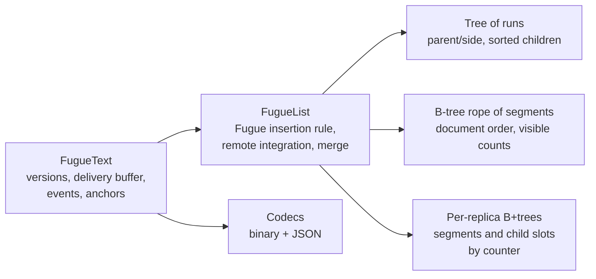

# fugue-text

A TypeScript implementation of the Fugue list CRDT for local-first collaborative text editing.
Replicas edit independently and converge, and Fugue minimises interleaving: text that people type
forwards at the same place at the same time stays in contiguous blocks instead of mixing
character by character.

[](https://github.com/aozmekik/fugue-text/actions/workflows/ci.yml)
[](LICENSE)

> **Status:** early, v0.1.0. The API and the encodings may change. Not yet published to npm.

## Why

Collaborative editors built on CRDTs let every replica edit offline and merge later. Many list
CRDTs, however, can _interleave_ concurrent insertions at the same position: two people typing
"eggs" and "bread" after the same line may end up with `ebgrgesad`. Weidner and Kleppmann's
[_The Art of the Fugue_](https://arxiv.org/abs/2305.00583) shows how to minimise this with a tree
whose in-order traversal is the document. This library implements that algorithm (Fugue), plus
what an editor integration needs: fast index lookups on long documents, run-length encoding,
causal delivery, state merging, compact encodings, stable cursors and change events. It has no
runtime dependencies and uses no platform-specific APIs.

## Features

- **Fugue semantics**: left/right children, sibling order by ID, in-order traversal; checked
  against a naive transcription of the paper's algorithm.
- **Fast on long documents**: O(log n) mapping between visible indexes and element IDs through a
  B-tree of run segments, and O(log n) edits inside long runs (a pasted file, say) through
  per-replica B+tree indexes.
- **Run-length encoding**: sequential typing is stored, sent and encoded as one run.
- **Operation-based sync**: serialisable operations, causal delivery with a buffer for
  out-of-order arrival, idempotent redelivery. A buffered operation that turns out to be invalid
  is dropped without failing the call that unblocked it or holding up unrelated operations.
- **State-based sync**: save, load and merge whole states (commutative, associative, idempotent).
- **Compact, deterministic encodings**: binary (varints, run-length records) and JSON for
  debugging; converged replicas produce byte-identical states.
- **Anchors**: caret and selection positions that survive concurrent edits.
- **Change events** for local and remote edits, to update a view incrementally.

## Install

Not yet published to npm. Install from GitHub (the `prepare` script builds the package):

```sh
npm install github:aozmekik/fugue-text
```

Requires Node.js 22 or newer (or a current browser through a bundler). The package is ESM;
`require()` also works on Node.js 22.12 and newer. Indexes count UTF-16 code units, like
JavaScript strings and `<textarea>`. The type declarations use generic typed arrays and need
TypeScript 5.7 or newer. CI installs the packed package into a fresh project and checks all of
this (`npm run check:package`).

## Quick start

```ts
import { decodeOperation, encodeOperation, FugueText } from 'fugue-text';

const alice = new FugueText({ replicaId: 'alice' });
const bob = new FugueText({ replicaId: 'bob' });

// Local edits apply immediately and return an operation to broadcast.
const op = alice.insert(0, 'milk\n');
if (op) bob.apply(op);

// Concurrent edits at the same position...
const fromAlice = alice.insert(5, 'eggs\n');
const fromBob = bob.insert(5, 'bread\n');

// ...can be delivered in any order, any number of times, as objects, JSON or bytes.
if (fromBob) alice.apply(decodeOperation(encodeOperation(fromBob)));
if (fromAlice) {
  bob.apply(fromAlice);
  bob.apply(fromAlice); // returns 'duplicate'
}

alice.toString() === bob.toString(); // true: "milk\neggs\nbread\n"
```

## API overview

| Member                                                           | Purpose                                                                                                                 |
| ---------------------------------------------------------------- | ----------------------------------------------------------------------------------------------------------------------- |
| `new FugueText({ replicaId?, onReject? })`                       | A new, empty replica. The ID defaults to a random 12-character string.                                                  |
| `text.insert(index, string)`                                     | Inserts locally; returns an `InsertOperation` (or `undefined` for `''`).                                                |
| `text.delete(index, length)`                                     | Deletes locally; returns a `DeleteOperation` (or `undefined` for 0).                                                    |
| `text.toString()`, `text.length`                                 | The current text and its length in UTF-16 code units.                                                                   |
| `text.apply(op)`                                                 | Integrates a remote operation: `'applied'`, `'buffered'` or `'duplicate'`.                                              |
| `text.pendingCount`                                              | Operations waiting for missing causal dependencies.                                                                     |
| `text.version`                                                   | Version vector (next expected counter per replica).                                                                     |
| `text.save()` / `FugueText.load(state)`                          | Encode / decode the full state (binary).                                                                                |
| `text.toJSON()`                                                  | The full state as readable JSON (`FugueText.load` accepts it too).                                                      |
| `text.merge(state)`, `mergeStates(a, b)`                         | State-based merge.                                                                                                      |
| `text.createAnchor(index, bias?)` / `text.resolveAnchor(anchor)` | Positions that survive edits.                                                                                           |
| `text.subscribe(listener)`                                       | Change events `{ origin: 'local' \| 'remote', changes }`; returns an unsubscribe function.                              |
| `encodeOperation(op)` / `decodeOperation(bytes)`                 | Binary operation codec (JSON works as is).                                                                              |
| `assertOperation(value)`                                         | Validates an operation parsed from untrusted input.                                                                     |
| `FugueTextError`                                                 | Thrown for malformed or inconsistent remote input (`code`: `invalid-operation`, `invalid-state` or `replica-conflict`). |

Operations, anchors and version vectors are plain JSON values; version vectors and `deps` created
by the library have no prototype, so any replica ID can be used as a key.

```ts
const caret = text.createAnchor(6); // sticks to the character on its left
const stop = text.subscribe(({ origin, changes }) => render(changes));
// ...remote operations arrive...
const index = text.resolveAnchor(caret); // the caret's index now
```

- **Errors.** `apply` and `merge` throw `FugueTextError` only for their own argument, and then
  leave the document unchanged. An operation can wait in the buffer and turn out to be invalid
  when its dependencies arrive (for example, its parent does not exist). It is then dropped and
  passed to the `onReject` callback, and the call that unblocked it still succeeds.
- **Change events.** Applying the `changes` of each event, in the order the events arrive, to the
  previous string yields the new string, so a view can be patched without re-rendering
  everything. An edit made inside a listener is delivered after the current event has reached
  every listener.
- **Anchors.** A `left` anchor stays after the character on its left, and a `right` anchor before
  the character on its right. That bias holds while the character is visible. Once it is
  deleted, the anchor resolves to the gap, but later insertions into that gap may land on either
  side of it. Re-create long-lived anchors after changes
  (`createAnchor(resolveAnchor(anchor), bias)`) to keep the bias.
- **Replica IDs** must be unique per live instance. Reuse an ID only when loading a state that
  contains every operation that ID has produced; otherwise use a fresh one (the default).

## How it works



- **Tree of runs.** Every character is a node of the Fugue tree, but a chain of characters typed
  one after another by the same replica is stored as one _run_. A local insert follows the paper:
  if the character before the cursor has no right child, the new text becomes its right child;
  otherwise it becomes the left child of the next element in document order.
- **Rope.** The tree's in-order traversal is kept in a B-tree of segments (slices of runs), with
  visible-character counts in every node and back-pointers from segments to leaves. Index to
  element and element to index are both O(log n). A remote insertion is placed right before the
  subtree of its next-greater sibling, or after the end of its parent's subtree.
- **Indexes.** Each replica's segments and child slots live in B+trees keyed by element counter,
  shared by all of that replica's runs. Splitting a segment or attaching a child costs O(log n),
  even inside a run that has been cut into thousands of pieces.
- **Causality.** Each replica numbers its insertions (one counter per character) and deletions
  (one counter each) in one sequence. An operation carries the version-vector entries that
  changed since its sender's previous operation. A receiver buffers it until those are satisfied,
  filed under the one condition it still waits for, so only the operations a new arrival can
  unblock are checked again.
- **Encoding.** States are encoded in document order as run-length records with varint and
  zigzag-delta integers; text is WTF-8 so even lone surrogates round-trip.

Design decisions and their trade-offs are recorded as ADRs:

1. [Tree of runs with a B-tree rope](docs/adr/0001-tree-of-runs-with-a-b-tree-rope.md), including
   the per-replica indexes
2. [Causal delivery with delta dependencies](docs/adr/0002-causal-delivery-with-delta-dependencies.md)
3. [Deterministic, compact state encoding](docs/adr/0003-deterministic-compact-state-encoding.md)
4. [Fugue, not FugueMax, in v0.1](docs/adr/0004-fugue-not-fuguemax.md)

## Correctness

`npm test` runs 113 tests in 12 files (Vitest 5.0.5, Node.js 22.22.3, Apple M1 Pro), including:

- **Convergence**: 2 to 5 replicas make random concurrent edits; operations are delivered in
  random order, duplicated, round-tripped through JSON and the binary codec, and mixed with state
  merges. All replicas must end with the same text, the same version and byte-identical encoded
  states, and a mirror string maintained only from change events must match after every step.
- **Differential testing** against [`test/support/reference.ts`](test/support/reference.ts), a
  naive transcription of the paper's Algorithm 1: every local insert must pick the same parent and
  side for every character, and every replica must show the same text after every delivery.
- **The paper's scenarios** (Figures 1, 2, 6 and 7) and properties: two or three users typing
  forwards, or backwards, at the same position on a random document. Each typist uses its own
  alphabet, so the test can check that every typist's characters form one contiguous block.
- **Delivery buffer**: invalid buffered operations are dropped and reported while other ready
  operations keep draining; conflicting duplicates, overlaps and forged dependencies are
  rejected; a 3,000-operation dependency chain delivered in reverse drains in one call.
- **Merge laws**: `mergeStates` is commutative, associative and idempotent on random states, and
  state-based sync agrees with operation-based sync.
- **Codecs**: round trips of arbitrary UTF-16 strings and of the largest allowed counters,
  fuzzing of both decoders with random and corrupted bytes (they may only throw
  `FugueTextError`), and specific malformed states.
- **Structure**: model-based tests of the B-tree rope and of the B+tree index, and an invariant
  check (rope order equals the tree traversal, maximal segments and runs, sorted siblings, every
  index consistent with the runs) after every property-test step.

`npm run test:coverage` on the same setup reports 98.99% of statements, 96.71% of branches and
100% of functions and lines in `src/` (excluding `src/types.ts`, which only declares types).
Property tests draw new random inputs on each run, so coverage varies by a fraction of a percent
between runs. Each property runs 200 cases by default. A soak run with
`FC_NUM_RUNS=20000 npx vitest run --testTimeout=0` (20,000 cases per property, 3 min 26 s on the
same machine while other jobs were running) also passed.

## Benchmarks

All numbers below come from one run of each benchmark on 2026-10-18, on an Apple M1 Pro (8 cores,
16 GB) with macOS 26.6.2, Node.js 22.22.3 (V8 12.4; the benchmarks run TypeScript through tsx
4.23.15) and Yjs 13.6.33. The machine was shared with other jobs: the 1-minute load average was
about 19 when `npm run bench` started and 16 when `npm run bench:scaling` started, and it
fluctuated during the runs. Timings are rounded to two or three significant figures and come
with the range over the measured runs; sizes are exact. Each benchmark writes every measured
duration to `bench/out/` (git-ignored).

### Real editing trace

`npm run bench` replays the
[automerge-paper trace](bench/traces/README.md) (259,778 single-character edits made while writing
a LaTeX paper; final length 104,852 characters; CC BY 4.0, Martin Kleppmann) on one replica,
then delivers the resulting operations to a second replica. Each timing is the median of 7 runs
after 2 warm-up runs, with the range in parentheses. Retained heap is measured in a fresh
process per library after a forced GC.

| Metric                                         | fugue-text                          | Yjs 13.6.33                         |
| ---------------------------------------------- | ----------------------------------- | ----------------------------------- |
| Local replay                                   | 82 ms (81 to 84), 3.2 M edits/s     | 1,080 ms (1,020 to 1,370), 0.24 M/s |
| Remote replay from binary messages             | 324 ms (319 to 336), 0.80 M edits/s | 1,290 ms (964 to 3,160), 0.20 M/s   |
| Remote replay from in-memory operation objects | 104 ms (103 to 106), 2.5 M edits/s  | n/a (updates are binary)            |
| Save full state                                | 4.6 ms (2.6 to 8.2)                 | 3.6 ms (2.4 to 17.9)                |
| Load full state                                | 21 ms (20 to 26)                    | 14 ms (6.7 to 23)                   |
| Encoded state, bytes                           | 176,415                             | 223,414 (v2 encoding: 159,921)      |
| Encoded state after gzip, bytes                | 80,574                              | 99,895                              |
| State as JSON, bytes                           | 1,539,776                           | n/a                                 |
| Binary operation or update, bytes per edit     | 18.8                                | 14.7                                |
| Retained heap after replay                     | 3.6 MB (3,622,168 bytes)            | 3.4 MB (3,446,848 bytes)            |

The trace produced 6,288 runs and 12,487 segments in fugue-text. Between runs, save times
varied by a factor of about 3 for fugue-text and 7 for Yjs, and Yjs load times by a factor of 3,
so read the save and load rows as orders of magnitude, not as a ranking. Decoding binary operations dominates the binary remote replay: applying the same
operations as objects is about 3 times faster.

### Cost per edit versus document size (synthetic)

`npm run bench:scaling` builds documents in two ways (synthetic data): from random typing bursts
(words of 1 to 8 characters at random positions, which produce many short runs), or with one
paste (a single long run, as when a file is opened and then edited). It then times 10,000 random
single-character edits (alternating insert and delete at uniformly random positions) on fresh
copies: median of 5 repetitions, with the range of the local fugue-text timings. The naive
reference implementation from the test suite (O(n) per edit, a single run of 500 edits) shows
what the B-tree avoids.

Typing bursts, µs per edit:

| Document length | fugue-text local   | fugue-text remote | Yjs local | Naive reference |
| --------------- | ------------------ | ----------------- | --------- | --------------- |
| 1,005           | 0.82 (0.68 to 1.1) | 0.89              | 4.7       | 46              |
| 10,002          | 0.95 (0.90 to 1.0) | 1.3               | 7.0       | 580             |
| 100,004         | 1.5 (1.4 to 1.7)   | 2.0               | 34        | not run (O(n))  |
| 1,000,005       | 4.1 (4.0 to 4.7)   | 5.8               | 390       | not run (O(n))  |

One paste, µs per edit:

| Document length | fugue-text local | fugue-text remote | Yjs local |
| --------------- | ---------------- | ----------------- | --------- |
| 1,000           | 1.9 (1.5 to 2.3) | 1.0               | 3.9       |
| 10,000          | 2.1 (1.9 to 2.2) | 1.3               | 5.9       |
| 100,000         | 2.4 (2.2 to 2.5) | 1.5               | 7.0       |
| 1,000,000       | 2.3 (2.1 to 2.6) | 1.5               | 10        |

The same command also pastes 1,000,000 characters and then makes 100,000 random edits in ten
batches of 10,000. The local cost per edit was 2.0, 1.8, 1.8, 1.9, 2.1, 2.1, 2.3, 2.1, 2.3 and
2.4 µs as the run was cut into 19,852 and finally 187,175 segments. Before the per-replica
indexes (ADR 0001), the cost per edit on this kind of workload grew linearly with the number of
segments.

### Caveats

These benchmarks give context; they are not a verdict on Yjs. Yjs is a mature framework with
rich types, awareness, transactions, observers, undo and garbage collection of deleted content,
and each `Y.Text` edit here runs in its own transaction with that machinery; fugue-text is a
single-purpose plain-text CRDT without tombstone garbage collection. The trace is a single-user
history, so it exercises sequential typing and never the concurrent-placement path. Uniformly
random positions in the scaling benchmark defeat the locality that Yjs's position cache relies on
and are not how people edit. Operation sizes depend on replica ID length (fugue-text sends the
ID string in every operation; Yjs uses numeric client IDs). The results come from a single run of
each benchmark on one machine that other jobs were using.

## Examples

- [`examples/broadcast-channel`](examples/broadcast-channel): a collaborative `<textarea>` across
  browser tabs over `BroadcastChannel`. `npm run example:browser`, then open
  http://127.0.0.1:8787 in two tabs. Text that others insert at your caret goes after it, so
  remote typing does not move your caret. Checked by hand in three tabs of Chrome 152 (concurrent
  typing, caret preservation, a late-joining tab, and a forged message that is ignored).
- [`examples/websocket-relay`](examples/websocket-relay): a tiny Node.js WebSocket relay (using
  the `ws` package, a dev dependency) with a client and an end-to-end demo:
  `npm run example:relay`. Clients and relay exchange states when a client connects, so edits made
  offline arrive on reconnect and a restarted relay is rebuilt from its clients. The relay
  forwards operations it has buffered before it can check them; every client checks what it
  applies.

## Limitations and roadmap

Current limitations:

- Tombstones are never garbage-collected, so memory and state size grow with editing history.
- No FugueMax variant (see [ADR 0004](docs/adr/0004-fugue-not-fuguemax.md)).
- Plain text only: no formatting marks, embedded objects or undo.
- Indexes are UTF-16 code units; deleting half of a surrogate pair is allowed (and round-trips).
- Synchronisation sends either single operations or whole states; there is no delta sync from a
  version vector yet, and the buffer of early operations is unbounded.
- Some input shapes cost more than O(log n) (see ADR 0001). Placing concurrent remote insertions
  walks `leftmost`/`rightmost` paths of the tree, which is linear in the number of runs on the
  path. Inserting among s siblings that share a parent costs O(s). Honest replicas rarely
  produce either, but a malicious peer can, so applications that accept input from untrusted
  peers should bound message sizes and rates.
- Anchors keep their bias only while their character is visible (see API overview).
- Counters are limited to 2^52 - 1 per replica. A replica ID that two _other_ replicas share is
  only detected when their operations conflict with buffered ones.

Roadmap (not committed):

- FugueMax as an opt-in algorithm with its own differential reference.
- Delta synchronisation (`changesSince(version)`) and a bounded operation buffer.
- Tombstone compaction for parts of the document every replica has seen.
- A concurrent editing-trace benchmark (for example the concurrent traces in
  josephg/editing-traces).

## Contributing

See [CONTRIBUTING.md](CONTRIBUTING.md) for setup, commands and guidelines. Changes are listed in
[CHANGELOG.md](CHANGELOG.md).

## References

- Matthew Weidner and Martin Kleppmann. _The Art of the Fugue: Minimizing Interleaving in
  Collaborative Text Editing._ [arXiv:2305.00583](https://arxiv.org/abs/2305.00583). This
  implementation follows the paper's Algorithm 1 (Fugue).
- Kevin Jahns, [Yjs](https://github.com/yjs/yjs): the benchmark baseline; its run-length encoded
  items are the best-known precedent for storing sequential typing as runs.
- [list-positions](https://github.com/mweidner037/list-positions) and
  [Collabs](https://github.com/composablesys/collabs): implementations of Fugue by the paper's
  first author. This library is an independent implementation from the paper; no code was taken
  from them.
- Joseph Gentle, [editing-traces](https://github.com/josephg/editing-traces) and Martin Kleppmann,
  [automerge-perf](https://github.com/automerge/automerge-perf): the benchmark trace.
- Simon Sapin, [The WTF-8 encoding](https://simonsapin.github.io/wtf-8/).

## License

[MIT](LICENSE) for the code. The vendored trace in `bench/traces/` is CC BY 4.0; see
[its README](bench/traces/README.md).

Built by [Ahmed Semih Özmekik](https://github.com/aozmekik) at [Fergani](https://fergani.tr).
